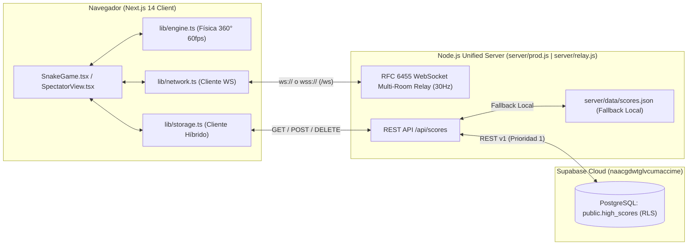

# Arquitectura del Sistema — Snake Arena Multiplayer

## 1. Visión General

`snake-next` es una aplicación **Next.js 14 (App Router) + TypeScript + Tailwind CSS** acompañada de un servidor **WebSocket RFC 6455 nativo en Node.js** sin dependencias externas de WebSockets. En producción (`server/prod.js`), tanto la aplicación Next.js como el servidor WebSocket y la API REST de puntajes operan sobre un **único puerto HTTP/WS unificado**, permitiendo su despliegue gratuito en Render.com.

---

## 2. Módulos Principales

### 2.1 Motor de Juego Continuo (`lib/engine.ts` y `lib/types.ts`)
- **Movimiento vectorial de 360°**: Las serpientes se desplazan con ángulo libre en radianes (`angle`, `targetAngle`) e interpolación angular suave limitada por velocidad de giro (`TURN_SPEED`).
- ** Colisiones**:
  - Colisión cabeza-borde del mapa (`WORLD_WIDTH`, `WORLD_HEIGHT`).
  - Colisión cabeza-cuerpo contra cualquier segmento de otra serpiente viva en la arena.
- **Comida y Power-ups**:
  - Frutas normales, doradas y *power-ups* de velocidad/escudo generados determinísticamente por el *Host* de la sala o el servidor local.
- **Modos de Juego**:
  - `single` (1 Jugador + Bots IA opcionales).
  - `local_mp` (2 Jugadores en el mismo teclado: WASD / Flechas o Mouse).
  - `lan_mp` (Multijugador en red / Internet hasta 4 jugadores por sala + espectadores ilimitados).

### 2.2 Servidor WebSocket RFC 6455 Multi-Sala (`server/relay.js` y `server/prod.js`)
- **Implementación pura sobre `http.Server` (`upgrade` event)**:
  - Handshake criptográfico `Sec-WebSocket-Accept` con SHA-1.
  - Decodificación y codificación de tramas binarias/texto con máscara XOR (`encodeFrame`, `decodeFrames`).
  - *Heartbeat* automático (`ping`/`pong`) cada 15 segundos para evitar cierres por inactividad en proxies reversos (Render/Cloudflare).
- **Gestión de Salas (`rooms` Map)**:
  - Cada sala mantiene hasta **4 slots de jugadores** (`slot 0` a `slot 3`) y **espectadores ilimitados**.
  - El **Slot 0** actúa como *Host* autoritativo de la física de la sala y emite `state_sync` a 30Hz.
  - Los clientes (`Slot 1..3`) envían `player_input` (ángulo deseado, boost, nombre y puntaje actual) y también sincronizan su `score` en cada paquete `player_input` y `update_name`.
  - **Reasignación dinámica de Host y cambio de Slot (`switch_slot`)**: Si el Host se desconecta o pasa a modo espectador, el servidor promueve automáticamente al siguiente jugador activo y emite `slot_assigned` a todos los miembros.

### 2.3 Persistencia Permanente en 3 Capas (`lib/storage.ts` + Supabase)
1. **Capa 1 — Supabase PostgreSQL (`public.high_scores`)**:
   - Tabla en el proyecto `naacgdwtglvcumaccime` con políticas RLS (`anon_select_high_scores`, `anon_insert_high_scores`, `anon_delete_high_scores`).
   - Consultada directamente desde `/api/scores` en `server/prod.js` y `server/relay.js` usando las variables `SUPABASE_URL` y `SUPABASE_ANON_KEY`.
2. **Capa 2 — Almacenamiento JSON en Servidor (`server/data/scores.json`)**:
   - Respaldo local automático cuando se juega en LAN sin conexión a Internet.
3. **Capa 3 — `localStorage` del Navegador**:
   - Caché inmediata en el cliente y sincronización silenciosa con `/api/scores`.
